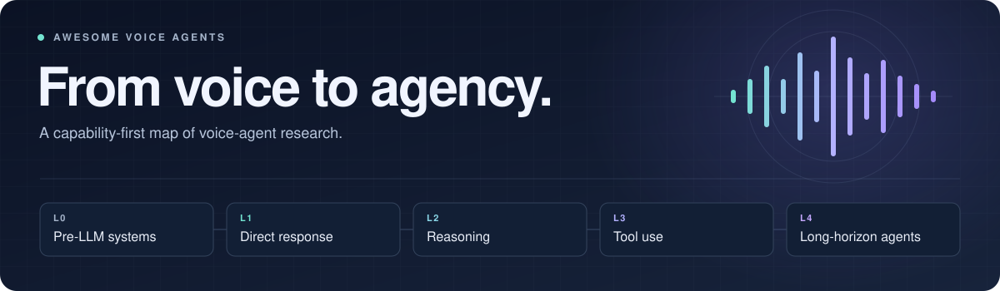

<p align="center">
  
</p>

<h1 align="center">Awesome Voice Agents</h1>

<p align="center">
  From spoken interaction to <strong>reasoning, tool use, and long-horizon action</strong>.
</p>

<p align="center">
  <a href="https://github.com/sindresorhus/awesome"></a>
  <a href="https://github.com/Kwwwww74/Awesome-Voice-Agent/stargazers"></a>
  <a href="https://github.com/Kwwwww74/Awesome-Voice-Agent/commits/main"></a>
  <a href="#survey"></a>
</p>

<p align="center">
  <a href="#research-collections">Browse papers</a> ·
  <a href="#capability-taxonomy">Explore the taxonomy</a> ·
  <a href="#how-to-contribute">Contribute</a> ·
  <a href="mailto:kaiwenluo74@gmail.com?subject=Voice%20Agent%20Paper%20Recommendation">Recommend a paper</a>
</p>

<a id="survey"></a>

## Survey · Coming Soon

> [!IMPORTANT]
> **Our survey on voice agents is coming soon!**
>
> We will share the paper and updates in this repository. Stay tuned!
>
> **Have a relevant paper to share?** We welcome recommendations, including your own work. Email [kaiwenluo74@gmail.com](mailto:kaiwenluo74@gmail.com?subject=Voice%20Agent%20Paper%20Recommendation) with the **paper title, link, and a brief description of its relevance**.

<a id="research-collections"></a>

## Research Collections

A curated collection of **137 papers, systems, and documented configurations**, organized into **five capability levels**.

| Level | Collection | Scope | Entries |
|---|---|---|---:|
| **L0** | [☎️ Pre-LLM Voice Systems](./papers/L0.md) | Rule-based, statistical, and specialized pre-LLM spoken systems | **27** |
| **L1** | [🎙️ Direct-Response Voice Models](./papers/L1.md) | LLM-era spoken interaction without demonstrated reasoning or tool use | **47** |
| **L2** | [🧠 Reasoning Voice Models](./papers/L2.md) | Explicit, latent, incremental, and duplex speech reasoning | **17** |
| **L3** | [🛠️ Tool-Using Voice Agents](./papers/L3.md) | Closed-loop retrieval, function calling, APIs, and environment actions | **43** |
| **L4** | [🧭 Long-Horizon Voice Agents](./papers/L4.md) | Persistent goals, multi-step execution, checking, repair, and replanning | **3** |
|  | **Total** |  | **137** |

Each collection is grouped by publication year and links directly to the corresponding paper, official documentation, or project page.

<details>
<summary><strong>On this page</strong></summary>

- [Survey · Coming Soon](#survey)
- [Research Collections](#research-collections)
- [Introduction](#introduction)
- [What Is a Voice Agent?](#what-is-a-voice-agent)
- [Capability Taxonomy](#capability-taxonomy)
- [Classification Rules](#classification-rules)
- [How to Contribute](#how-to-contribute)
- [Citation](#citation)
- [Star History](#star-history)
- [Acknowledgement](#acknowledgement)

</details>

---

<a id="introduction"></a>

## Introduction

Voice agents combine speech interaction with the ability to make decisions and advance a user goal. Earlier systems relied on rules, task trees, statistical dialogue policies, and specialized neural components. Recent systems increasingly use large language models to reason over spoken input, invoke tools, maintain task state, and act in external environments.

This repository provides:

- a capability-oriented taxonomy spanning the pre-LLM and LLM eras;
- curated collections for direct response, reasoning, tool use, and long-horizon execution;
- operational criteria for distinguishing adjacent levels;
- links to papers, technical reports, official documentation, and project pages.

The taxonomy is intentionally **architecture-agnostic**. A voice agent may use a cascaded ASR–LLM–TTS pipeline, an end-to-end speech language model, or a hybrid design.

**Collection last updated:** September 26, 2026

---

<a id="what-is-a-voice-agent"></a>

## What Is a Voice Agent?

We use the following working definition:

> A **voice agent** is an interactive system that receives spoken input, maintains relevant conversational or task state, selects a communicative or external action, and uses the resulting observation to advance a user request or delegated goal.

This definition separates voice agents from systems that only transcribe, synthesize, or classify audio. Standalone ASR, TTS, voice activity detection, datasets, and benchmarks may enable voice agents, but they are not themselves assigned an agent level.

### Capability versus interaction quality

The L0–L4 scale measures **agentic capability**, not overall system quality. The following properties are important but orthogonal to the level:

- latency and streaming efficiency;
- turn-taking, interruption, and full-duplex interaction;
- naturalness, emotion, persona, and voice quality;
- multilingual and multimodal support;
- safety, privacy, robustness, and accessibility.

---

<a id="capability-taxonomy"></a>

## Capability Taxonomy

> [!NOTE]
> Levels describe the **highest capability demonstrated by a concrete system or evaluated configuration**. Natural speech, low latency, full-duplex interaction, multimodality, or a long conversation does not by itself establish a higher level.

| Level | Category | Operational criterion | Insufficient evidence |
|---|---|---|---|
| **L0** | **Pre-LLM Voice Systems** | Uses rules, task trees, statistical dialogue policies, or specialized pre-LLM models as the central dialogue and task controller. | Real-world actions or database access do not move a pre-LLM architecture into an LLM-era level. |
| **L1** | **Direct-Response Voice Models** | Produces context-sensitive spoken responses without a demonstrated intermediate reasoning process, autonomous tool loop, or long-horizon controller. | Fluent conversation, full duplex, interruption handling, emotion, persona, or long context alone. |
| **L2** | **Reasoning Voice Models** | Demonstrates explicit, implicit, latent, incremental, or speech-time reasoning that affects the response or decision. | A component named “Thinker,” a prompt to think, or stronger final answers without evidence of a reasoning mechanism. |
| **L3** | **Tool-Using Voice Agents** | Selects and invokes an external tool, retrieval system, API, skill, or environment action, then uses the observation to continue the interaction. | A fixed pipeline, externally triggered retrieval, or merely producing a function-call string without consuming its result. |
| **L4** | **Long-Horizon Voice Agents** | Maintains a persistent goal and task state across a complex multi-step task, coordinating tools and checking, repairing, or replanning execution. | Long audio, many dialogue turns, multiple scripted tool calls, or a single fixed workflow without adaptation. |

### Level progression

```text
L0  Pre-LLM control
 │
 ▼
L1  Direct spoken response
 │   + demonstrated reasoning
 ▼
L2  Reasoning over spoken interaction
 │   + closed-loop external tool use
 ▼
L3  Tool-using voice agent
 │   + persistent goals, multi-step execution, and repair
 ▼
L4  Long-horizon voice agent
```

L0 is a historical architecture category. L1–L4 describe the highest demonstrated capability of LLM-era systems and configurations.

---

<a id="classification-rules"></a>

## Classification Rules

1. **Classify the concrete configuration.** A model family or platform may appear at different levels when different configurations expose different capabilities.
2. **Assign the highest demonstrated level.** Marketing claims or architectural potential are not treated as demonstrated capability.
3. **Keep L0 historical.** Pre-LLM systems remain L0 even when they can query databases, control devices, or complete constrained real-world tasks.
4. **Require evidence for reasoning.** L2 needs an identifiable reasoning mechanism, reasoning-oriented training objective, or reasoning evaluation.
5. **Require a closed tool loop.** L3 requires the agent to select or initiate an external operation, observe its result, and use that result in subsequent behavior.
6. **Require persistent execution for L4.** L4 needs goal and task-state maintenance together with multi-step execution and completion checking, correction, recovery, or replanning.
7. **Separate capability from quality.** Naturalness, latency, duplex communication, emotion, and multimodality are descriptive dimensions rather than level-defining criteria.

### Quick decision procedure

```text
Is the central controller a pre-LLM architecture?
├── Yes → L0
└── No
    ├── Persistent goal + multi-step execution + repair/replanning? → L4
    ├── Closed-loop external tool or environment interaction?      → L3
    ├── Demonstrated intermediate reasoning process?               → L2
    └── Interactive spoken response?                               → L1
```

---

<a id="how-to-contribute"></a>

## How to Contribute

Help us keep the collection useful and up to date. Recommend a paper by [email](mailto:kaiwenluo74@gmail.com?subject=Voice%20Agent%20Paper%20Recommendation), open an [issue](https://github.com/Kwwwww74/Awesome-Voice-Agent/issues), or submit a pull request.

For email recommendations, please include the **paper title, link, and a brief description of its relevance to voice agents**. You are welcome to share your own work.

For questions about the collection or the upcoming survey, contact [kaiwenluo74@gmail.com](mailto:kaiwenluo74@gmail.com).

---

<a id="citation"></a>

## Citation

If this repository is useful for your research, please cite it as:

```bibtex
@misc{luo2026awesomevoiceagents,
  title        = {Awesome Voice Agents},
  author       = {Luo, Kaiwen and Contributors},
  year         = {2026},
  howpublished = {\url{https://github.com/Kwwwww74/Awesome-Voice-Agent}},
  note         = {A curated collection and capability taxonomy for voice agents}
}
```

---

<a id="star-history"></a>

## Star History

<details>
<summary>View the star history chart</summary>

[](https://star-history.com/#Kwwwww74/Awesome-Voice-Agent&Date)

</details>

---

<a id="acknowledgement"></a>

## Acknowledgement

- Maintainer: [Kaiwen Luo](https://kwwwww74.github.io), [Yang Xiao](https://swagshaw.github.io), [Tianyu Shao](https://scholar.google.com/citations?user=9acFMiUAAAAJ&hl=en)
- The repository structure is inspired by [Awesome Trustworthy Audio-LLMs](https://github.com/Kwwwww74/Awesome-Trustworthy-AudioLLMs).
- Thanks to all researchers, engineers, and contributors advancing voice-agent research.

If you find this repository useful, please consider giving it a ⭐ and sharing it with the community.
